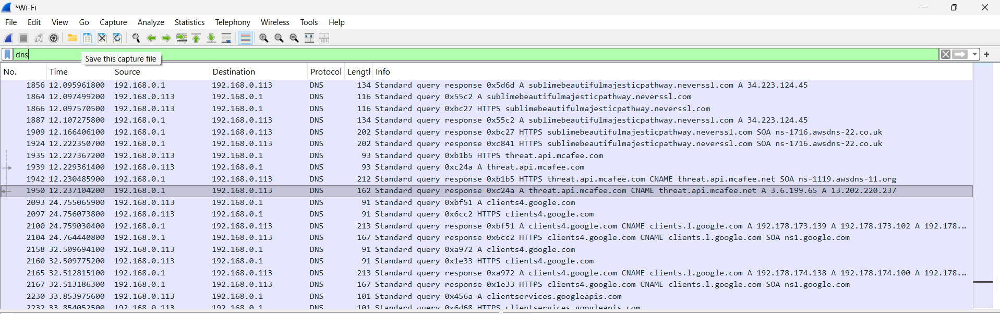
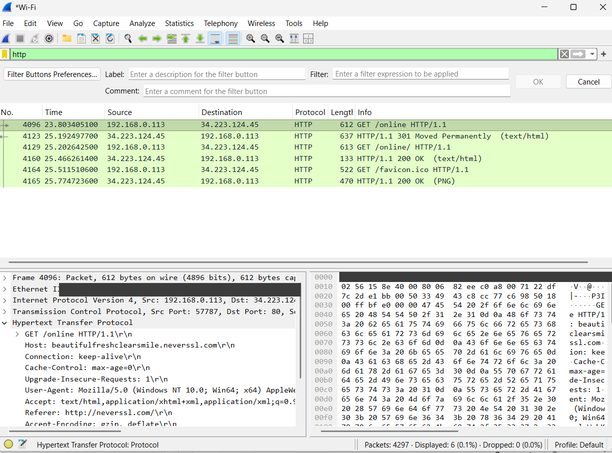
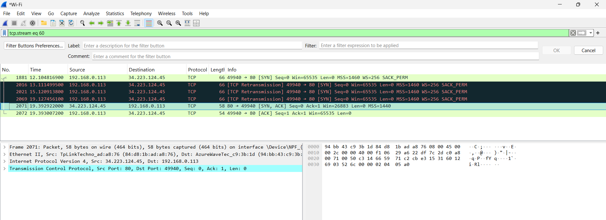
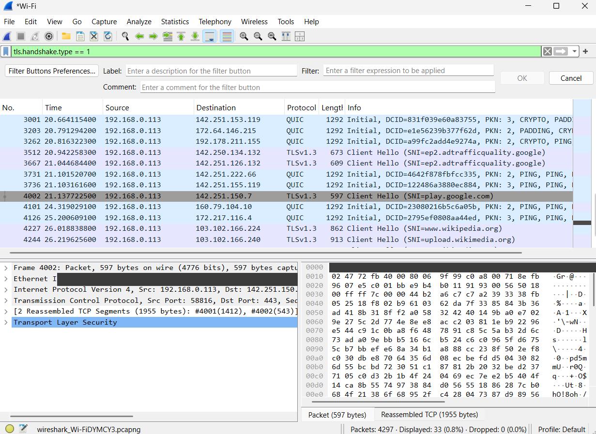
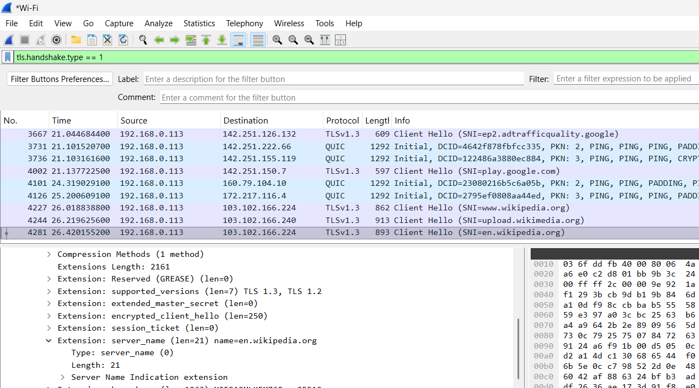
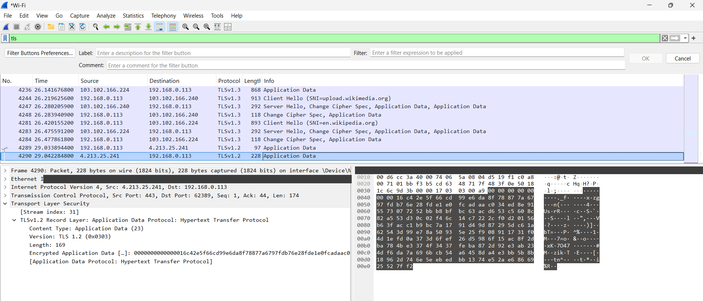

# Network Traffic Analysis with Wireshark

Hands-on packet analysis of my own network traffic using **Wireshark**. I captured live traffic on my Wi-Fi interface, filtered by protocol, and inspected DNS, HTTP, and TCP packets to understand what is visible on the wire and what that means for security.

> **Disclaimer:** All captures were taken on my own device and my own home network. No other users' traffic was intercepted. Capture files (`.pcap`) are not published because they contain personal browsing data.

---

## Lab environment

| Item | Details |
|---|---|
| Tool | Wireshark |
| Capture interface | Wi-Fi (own laptop) |
| Network | Home network (private range `192.168.0.0/24`) |
| Local host | `192.168.0.113` |
| Gateway / DNS resolver | `192.168.0.1` |
| Filters used | `dns`, `http`, `tcp` |

---

## Objectives

1. Capture live traffic and apply display filters to isolate protocols.
2. Analyse **DNS** queries and responses.
3. Show that **HTTP** traffic is sent in cleartext and identify what an observer can read.
4. Analyse **TCP** packet structure and connection behaviour.
5. Compare **HTTP vs HTTPS** to see exactly what encryption protects and what it still leaves visible.

---

## Findings

### 1. DNS analysis (`dns` filter)

- Applying the `dns` filter reduced the capture to **16 of 355 packets (4.5%)**, which makes the DNS exchange easy to read.
- My device (`192.168.0.113`) sent standard queries over **UDP port 53** to the home router (`192.168.0.1`), which acts as the DNS resolver.
- I observed query and response pairs for domains such as `web.whatsapp.com` and `tzm.protechts.net`, including **A** and **HTTPS** record lookups and **CNAME** answers.
- One lookup returned *"No such name"*, showing how failed resolutions appear.
- **Security takeaway:** standard DNS is unencrypted, so anyone on the same network path can see which domains a device is looking up, even when the website itself uses HTTPS. Encrypted DNS (DNS over HTTPS / TLS) reduces this exposure.

### 2. HTTP cleartext analysis (`http` filter)

- I browsed to a plain-HTTP test site (`neverssl.com`) and filtered with `http`, which showed the request (frame 6713) and its response (frame 6717).
- The packet details expose the full request in readable text: the `GET` request line, `Host`, `User-Agent`, `Accept`, and `Accept-Language` headers. The raw packet bytes show the same text in the hex/ASCII view.
- The request went from `192.168.0.113` to `34.223.124.45` on **TCP port 80**.
- **Security takeaway:** HTTP offers no encryption. Anyone able to capture the traffic could read the URL, query parameters, headers, and any data submitted, such as login credentials on a non-HTTPS site. This is why HTTPS is essential.

### 3. TCP analysis (`tcp` filter)

- The `tcp` filter displayed **6,543 of 9,642 packets (67.9%)**, showing that TCP carried most of the traffic in this capture.
- In the packet detail pane I reviewed the TCP header fields: source and destination ports (`64889` to `443`), sequence and acknowledgment numbers, segment length, and flags.
- Frame 9335 is a **`[RST, ACK]`** packet sent from my device to `150.171.109.130` on port 443. Wireshark highlights it in red because a reset ends a connection abruptly instead of closing it with the normal FIN sequence.
- **Takeaway:** reading flags and sequence numbers is the foundation for diagnosing connection problems and spotting suspicious behaviour such as repeated resets or scans.

### 4. HTTP vs HTTPS comparison

**HTTP (readable):**

- The `http` filter showed **6 of 4,297 packets (0.1%)**: a `GET /online`, a `301 Moved Permanently` redirect, a second `GET /online/`, a `200 OK` response, and a `favicon.ico` request and response.
- The request details are plain text, including the `Host`, `Referer`, `User-Agent`, and `Accept` headers, and the same text appears in the raw packet bytes.

**HTTPS (domain visible, content hidden):**

- Filtering with `tls.handshake.type == 1` isolated the **Client Hello** messages (**33 of 4,297 packets**). The Info column already shows the destination names, such as `www.wikipedia.org`, `upload.wikimedia.org`, `en.wikipedia.org`, and `play.google.com`.
- Expanding the packet to *Extension: server_name* shows `name=en.wikipedia.org` in clear text. This is the **Server Name Indication (SNI)**, sent before encryption starts so the server knows which certificate to present.
- Some connections appear as **QUIC** (HTTP/3) rather than TCP-based TLS.

- Filtering with `tls` and opening an **Application Data** packet shows *Encrypted Application Data*, and the raw bytes are unreadable. Wireshark labels the inner protocol as HTTP, but the actual requests, URLs, headers, and page content cannot be read without the session keys.
- For the Wikipedia connections the handshake after the Server Hello (Change Cipher Spec and Application Data) is also encrypted.

**Conclusion:** HTTPS hides the page content, URL path, and headers, but an observer can still see **which server** I connected to (through DNS lookups and the SNI), the destination IP address, and the timing and size of the traffic. HTTPS protects content, not the fact that a connection happened.

---

## What an observer can and cannot see

| Traffic | Visible to a network observer |
|---|---|
| DNS (standard) | Domain names being looked up |
| HTTP | Full request and response, including headers and content |
| HTTPS | Destination IP, domain (DNS lookup and SNI), and traffic timing and size; page content, URL path, and headers are encrypted |

---

## Skills demonstrated

- Live packet capture and display filtering in Wireshark
- Protocol analysis: DNS, HTTP, TCP
- Reading packet headers, flags, ports, and raw bytes
- Explaining the security impact of unencrypted protocols
- Documenting technical findings clearly

---

